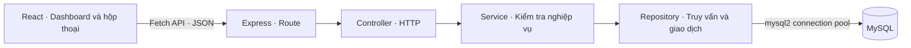

# Project I · Website quản lý trường THPT

Ứng dụng web hỗ trợ quản lý năm học, lớp và chuyên cần trong một trường THPT. Repository hiện có dashboard tiếng Việt, chức năng quản lý năm học và schema MySQL cho các nghiệp vụ tiếp theo.

## Mục lục

- [Chức năng](#chức-năng)
- [Công nghệ và kiến trúc](#công-nghệ-và-kiến-trúc)
- [Cấu trúc repository](#cấu-trúc-repository)
- [Cài đặt](#cài-đặt)
- [Khởi chạy](#khởi-chạy)
- [API](#api)
- [Kiểm thử](#kiểm-thử)
- [Lộ trình và đóng góp](#lộ-trình-và-đóng-góp)

## Chức năng

- **Dashboard** có thanh điều hướng, trang tổng quan và trang giữ chỗ cho các mục đang phát triển.
- **Quản lý năm học** hỗ trợ thêm, xem danh sách, tìm theo mã, lọc trạng thái, sửa và xóa. Biểu mẫu thêm và sửa mở trong hộp thoại ngay trên danh sách.
- **Tên và trạng thái** được sinh trên giao diện. Năm bắt đầu `2026` cho mã `2026-2027`. Trạng thái được tính theo ngày tại Việt Nam và gồm sắp diễn ra, đang diễn ra, đã kết thúc.
- **Học kỳ và ghi chú** có thể được lưu khi tạo năm học. Giao diện bật sẵn tùy chọn tạo hai học kỳ liên tiếp, gần bằng nhau. Ghi chú là tùy chọn, tối đa 500 ký tự.
- **Bảo toàn dữ liệu** khi sửa hoặc xóa. Năm học đã có học kỳ hoặc lớp vẫn sửa được mã và ghi chú. Khoảng ngày bị khóa trong các trường hợp này. Xóa năm học sẽ xóa các học kỳ đi kèm trong cùng giao dịch. Nếu đã có lớp tham chiếu, yêu cầu bị từ chối.

## Công nghệ và kiến trúc

| Thành phần | Công nghệ |
| --- | --- |
| Frontend | React và React DOM 19.3.1, Vite 8.3.8, React plugin 6.3.0 |
| Backend | Node.js, Express 5.3.0, CORS 2.8.6, dotenv 18.0.10 |
| Cơ sở dữ liệu | MySQL 8.0.16 trở lên, InnoDB, `utf8mb4`, driver `mysql2` 3.24.6 |
| Kiểm tra và khởi chạy | Oxlint 1.93.0, npm, PowerShell |

Các phiên bản thư viện trong bảng lấy từ lockfile.



Frontend điều hướng theo URL hash. Lớp gọi API nằm riêng với component hiển thị. Backend kiểm tra dữ liệu đầu vào trước khi lưu, dùng truy vấn có tham số và dùng giao dịch cho thao tác ghi năm học cùng học kỳ.

## Cấu trúc repository

```text
.
├── backend/
│   ├── .env.example
│   └── src/
│       ├── app.js, server.js
│       ├── config/
│       ├── routes/
│       ├── controllers/
│       ├── services/
│       ├── repositories/
│       └── scripts/
├── frontend/
│   ├── .env.example
│   └── src/
│       ├── api/
│       ├── components/
│       ├── App.jsx
│       └── navigation.js
├── database/
│   ├── schema.sql
│   ├── setup-user.sql
│   ├── migrations/
│   └── seed.sql
├── documentation/
├── AGENTS.md
└── start.ps1
```

- `backend/` chứa API và các lệnh kiểm tra kết nối, nạp dữ liệu mẫu.
- `frontend/` chứa giao diện React, điều hướng và mã gọi API.
- `database/` chứa schema, script cấp quyền, migration và dữ liệu mẫu.
- `documentation/` chứa [yêu cầu nghiệp vụ](documentation/requirements.md) và [thiết kế cơ sở dữ liệu](documentation/database.md).

## Cài đặt

### Yêu cầu môi trường

- Node.js `^20.19.0 || >=22.12.0` theo yêu cầu của công cụ frontend. Môi trường đã kiểm tra dùng Node.js 24.19.0 và npm 11.17.0.
- MySQL Server 8.0.16 trở lên, đang chạy. Cần tài khoản quản trị để tạo schema, cấp quyền và chạy migration. Có thể dùng MySQL Workbench cho các bước SQL.
- PowerShell trên Windows để dùng launcher `start.ps1`.

### Cài dependencies

Từ thư mục gốc repository, chạy:

```powershell
Set-Location backend
npm.cmd ci
Set-Location ../frontend
npm.cmd ci
Set-Location ..
```

### Cấu hình môi trường

Nếu chưa có file `.env`, sao chép các file mẫu từ thư mục gốc:

```powershell
Copy-Item backend/.env.example backend/.env
Copy-Item frontend/.env.example frontend/.env
```

| File | Biến | Giá trị mẫu | Mục đích |
| --- | --- | --- | --- |
| `backend/.env` | `PORT` | `3000` | Cổng API |
| `backend/.env` | `CLIENT_ORIGIN` | `http://localhost:5173` | Origin frontend được CORS cho phép |
| `backend/.env` | `DB_HOST` | `127.0.0.1` | Máy chủ MySQL |
| `backend/.env` | `DB_PORT` | `3306` | Cổng MySQL |
| `backend/.env` | `DB_USER` | `school_app` | Tài khoản MySQL của ứng dụng |
| `backend/.env` | `DB_PASSWORD` | `<mật khẩu của school_app>` | Điền giá trị thật trong file cục bộ |
| `backend/.env` | `DB_NAME` | `school_management` | Tên schema |
| `frontend/.env` | `VITE_API_URL` | `http://localhost:3000` | Địa chỉ gốc của API |

Giữ `.env` ngoài Git. Các biến `VITE_*` có thể xuất hiện trong mã JavaScript phía trình duyệt, nên chỉ đặt cấu hình công khai ở đó.

### Thiết lập MySQL

1. Chạy [database/schema.sql](database/schema.sql) bằng tài khoản quản trị để tạo schema `school_management`, 12 bảng và hai vai trò `ADMIN`, `GVCN`.
2. Chạy [database/setup-user.sql](database/setup-user.sql) theo [hướng dẫn MySQL](database/README.md) để cấp quyền đọc và ghi dữ liệu cho `school_app`. Cập nhật mật khẩu tương ứng trong `backend/.env`.
3. Nếu database đã được tạo từ schema cũ và bảng `NAM_HOC` chưa có cột `GhiChu`, chạy một lần [migration 001](database/migrations/001_academic_year_note.sql). Schema hiện tại đã bao gồm cột này khi tạo mới.

Để nạp dữ liệu mẫu, chạy `npm.cmd run db:seed` trong `backend`. Lệnh thực thi toàn bộ [database/seed.sql](database/seed.sql), gồm năm học, học kỳ và lớp mẫu. Dùng trên database phát triển. Các năm học đã tồn tại và dữ liệu đi kèm được giữ nguyên. Khi mở rộng file, đặt dữ liệu cha trước dữ liệu phụ thuộc và giữ dòng `-- seed:statement` giữa các câu lệnh.

## Khởi chạy

Chạy từ thư mục gốc:

```powershell
.\start.ps1
```

Launcher kiểm tra kết nối MySQL, API và frontend rồi mở `http://localhost:5173`. Thêm `-Seed` để nạp dữ liệu mẫu hoặc `-NoBrowser` để giữ trình duyệt đóng. Nhấn **Ctrl+C** để dừng các server do launcher khởi động. Trên web, chọn **Tác vụ → Quản lý năm học**.

Có thể chạy thủ công từ hai terminal ở thư mục gốc:

```powershell
# Terminal 1
Set-Location backend
npm.cmd start
```

```powershell
# Terminal 2
Set-Location frontend
npm.cmd run dev -- --port 5173 --strictPort
```

`npm.cmd run dev` trong backend bật Node watch mode. Frontend có thể build bằng `npm.cmd run build` và xem bản build cục bộ bằng `npm.cmd run preview`. Tại cổng preview `4173`, đặt `CLIENT_ORIGIN=http://localhost:4173` trước khi khởi động lại backend. Repository chưa có quy trình triển khai production, và API hiện chưa có xác thực.

## API

Địa chỉ mặc định là `http://localhost:3000`.

| Phương thức | Đường dẫn | Kết quả thành công |
| --- | --- | --- |
| `GET` | `/api/health` | `200` và trạng thái API. Route này không truy vấn MySQL. |
| `GET` | `/api/academic-years` | `200` và danh sách năm học trong `data` |
| `POST` | `/api/academic-years` | `201` và bản ghi vừa tạo trong `data` |
| `PUT` | `/api/academic-years/:id` | `200` và bản ghi vừa cập nhật trong `data` |
| `DELETE` | `/api/academic-years/:id` | `200` và ID đã xóa trong `data.id` |

Ví dụ JSON cho yêu cầu tạo:

```json
{
  "code": "2026-2027",
  "startDate": "2026-09-05",
  "endDate": "2027-05-31",
  "note": "Năm học mẫu",
  "createSemesters": true
}
```

Khi sửa, gửi `code`, `startDate`, `endDate` và `note` nếu cần giữ hoặc cập nhật ghi chú. Chức năng tạo học kỳ áp dụng khi tạo năm học. Bản ghi trả về gồm `id`, `code`, `startDate`, `endDate`, `note` và `semesterCount`. Những lỗi thường gặp gồm `400` khi dữ liệu sai, `404` khi năm học không tồn tại và `409` khi trùng mã hoặc xung đột dữ liệu liên quan.

## Kiểm thử

| Thư mục | Lệnh | Nội dung kiểm tra |
| --- | --- | --- |
| `backend` | `npm.cmd run db:check` | Kết nối được tới MySQL và đọc được tên schema |
| `frontend` | `npm.cmd run lint` | Kiểm tra mã nguồn bằng Oxlint |
| `frontend` | `npm.cmd run build` | Tạo bản build trong `frontend/dist/` |

Khi hệ thống đang chạy, có thể kiểm tra hai API đọc từ PowerShell:

```powershell
Invoke-RestMethod http://localhost:3000/api/health
Invoke-RestMethod http://localhost:3000/api/academic-years
```

Kiểm thử thủ công trên trang **Quản lý năm học**:

1. Tạo năm học bằng mã chưa tồn tại và bật tạo học kỳ. Sau khi tải lại trang, xác nhận ghi chú và số học kỳ vẫn đúng.
2. Thử mã trùng và ngày kết thúc bằng hoặc trước ngày bắt đầu. Giao diện phải báo lỗi và giữ dữ liệu đã nhập.
3. Sửa ghi chú và xác nhận danh sách tự làm mới. Thử đổi ngày của năm đã có học kỳ để kiểm tra quy tắc bảo vệ khoảng ngày.
4. Xóa bản ghi kiểm thử chưa có lớp. Nếu đã nạp seed trên database mới, thử xóa năm `2028-2029` và xác nhận lớp mẫu khiến yêu cầu bị từ chối.

Repository hiện chưa có script `npm test`.

## Lộ trình và đóng góp

Phạm vi MVP xác định hai vai trò **Admin** và **GVCN (giáo viên chủ nhiệm)**. Hiện đã có dữ liệu danh mục vai trò trong schema. Chức năng đăng nhập và kiểm tra quyền chưa được triển khai.

Theo [đề cương](documentation/requirements.md), các phần tiếp theo gồm đặt năm học hiện hành, quản lý học kỳ và lớp, hồ sơ và xếp lớp học sinh, phân công chủ nhiệm, điểm danh, thống kê chuyên cần và nhật ký thao tác. Schema đã có bảng nền cho các nghiệp vụ này.

Khi đóng góp, đọc [AGENTS.md](AGENTS.md), cập nhật API và giao diện theo kiến trúc hiện có, thêm migration khi thay đổi schema đã triển khai và kiểm tra lại luồng trên web. Các màn hình quản lý danh sách dùng đủ CRUD theo quyền nghiệp vụ, với hộp thoại cho thao tác thêm và sửa.

**Sinh viên thực hiện** Nguyễn Đức Thiện. **Giảng viên hướng dẫn** Đỗ Tuấn Anh. Thông tin lấy từ [đề cương dự án](documentation/requirements.md).
